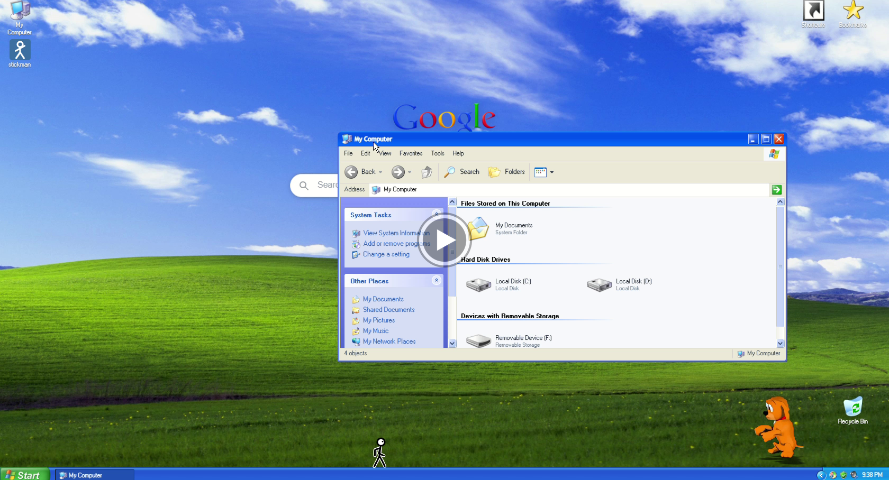
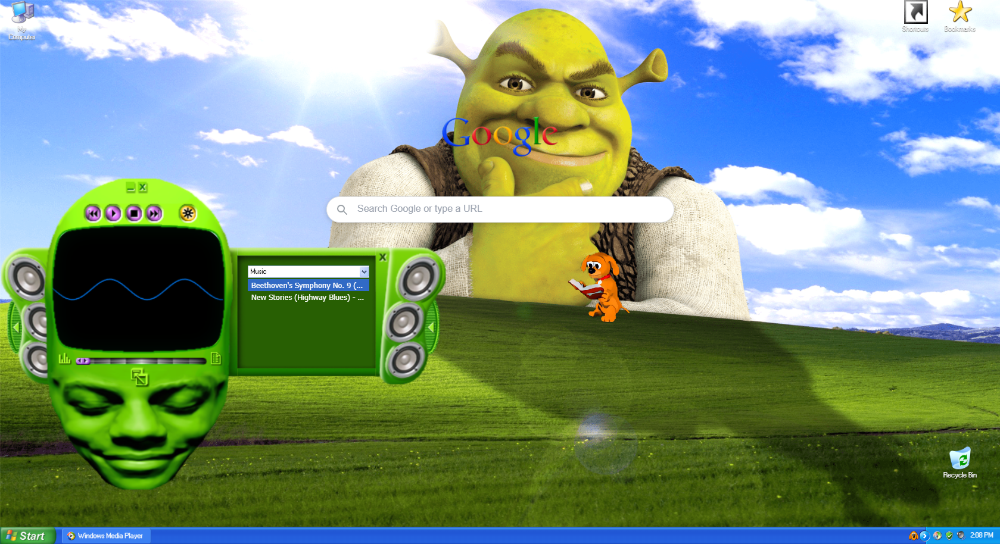

# Windows XP Simulator - New Tab Companion Extension (Chromium MV3)

[](https://support.xpsimulator.com)
[](https://xpsimulator.com)
[](https://extension.xpsimulator.com)
[](https://docs.xpsimulator.com)
[](https://github.com/elmehdi-khalda/xpsimulator-sc)
[](manifest.json)
[](LICENSE)

The official Chromium companion extension for **[Windows XP Simulator](https://xpsimulator.com)**. It transforms browser new tabs into a fully interactive Windows XP desktop environment, unblocks live web browsing inside Internet Explorer 6 via declarative net rules, and imports your bookmarks and shortcuts directly to the retro desktop.

Detailed documentation, developer manual, and app injection guide available at **[extension.xpsimulator.com](https://extension.xpsimulator.com)**.

Architecture & source code updates: **[elmehdi-khalda/xpsimulator-sc](https://github.com/elmehdi-khalda/xpsimulator-sc)**

---

## Interactive Application Demo: Stickman

Experience autonomous desktop applications built on the Windows XP Simulator SDK.

[](https://r2-cors-proxy.elmehdikhalda.workers.dev/elmehdikhalda/videos/stickman.mp4)

<div align="center">
  <a href="https://docs.xpsimulator.com/#app-examples">
    
  </a>
</div>

---

## Visual Showcase Gallery

### 1. Windows Media Player & Desktop Workspace


*Windows Media Player with dynamic Headspace skin, authentic audio synthesis, and full retro workspace environment.*

---

### 2. Wallpapers & Headspace Skins


*Dynamic bliss wallpapers, customized system themes, and real-time Headspace skin transformations.*

---

### 3. Classic Google Search


*Vintage Google Search interface running inside Internet Explorer with authentic period styling.*

---

### 4. The Classic Google Search Index


*Full-fidelity retro Google search index and live web directory navigation.*

---

### 5. Classic YouTube Experience


*Authentic Internet Explorer 6 window running YouTube retro video playback with native controls and sound.*

---

### 6. Multiple Apps in the Start Menu


*Multi-application productivity suite accessible from the authentic two-column Windows XP Start Menu.*

---

### 7. Lock Screen & Password Protection


*Authentic Windows XP welcome and lock screen with multi-user profiles and password validation.*

---

### 8. Sticky Notes


*Desktop sticky notes and workspace productivity tools with automatic state persistence.*

---

### Meme Pack 1 Desktop Suite


*Optional vintage meme packs: ishowmusic, meme wallpapers and creative wallpapers*

---

## Core Features and Architecture

### 1. New Tab Replacement
Every new tab session initialises the desktop environment with persistent local state:
- Pixel-aligned Bliss wallpaper, Luna taskbar, system tray, and start menu hierarchy.
- Virtual file system backed by IndexedDB storage with drag-and-drop operations.
- Offline resilience with automatic fallback mechanisms.

### 2. Chrome Bookmarks and Shortcuts Import
The extension bridges the host browser with the simulated desktop:
- **Import Bookmarks**: Read your browser bookmarks hierarchy and generate authentic `.url` desktop shortcuts with favicons on the XP desktop.
- **Import Shortcuts**: Seamlessly import your top visited websites and new-tab speed dial shortcuts into the virtual system.
- Completely local processing stored in client-side IndexedDB with zero cloud telemetry.

### 3. Declarative Net Request Header Unblocking
Modern web applications enforce restrictions that limit iframe embedding (`X-Frame-Options` and `Content-Security-Policy: frame-ancestors`). This extension leverages Chrome Manifest V3 declarative rules (`rules/rules.json`) to strip restriction headers exclusively for simulator sessions:
- Strips `x-frame-options`, `content-security-policy`, `frame-ancestors`, and `cross-origin-embedder-policy`.
- Scope is strictly constrained to traffic initiated by the simulator frame origin (`https://xpsimulator.com` and local development hosts).

### 4. Desktop Display and Brightness Control
The extension options panel includes real-time display controls:
- Hardware-accelerated CSS filter adjustments for screen brightness from 20% to 150%.
- Dynamic contrast and saturation calibration for vintage CRT simulation.
- Preserves display preferences across browsing sessions via browser storage.

### 5. Context Menu Integration: Open Link with Internet Explorer
The extension injects a context menu action accessible across all web pages:
- Right-click any URL or link and select **Open with Internet Explorer**.
- Opens a new tab directly into the simulator with Internet Explorer 6 navigating to the selected URL.

### 6. One-Click Configuration Profiles
Preconfigured profiles allow switching operational modes instantly:
- **Default Profile**: Standard authentic Luna visual layout and preinstalled suite.
- **Minimalist Profile**: Lightweight productivity view without background media layers.
- **Developer Profile**: Enables console bridge debug output and SDK inspect tools.

### 7. Dedicated Meme Pack Section
The extension options popup features a dedicated Meme Pack section:
- Easily toggle Meme Pack 1 on and off.
- Enables retro internet humor, meme audio cues, and custom assets without modifying core virtual files.

---

## Installation

### From Source (Developer Mode)
1. Clone the repository:
   ```bash
   git clone https://github.com/elmehdi-khalda/xpsimulator-newtab.git
   ```
2. Navigate to `chrome://extensions` in Chromium (Chrome, Brave, Edge).
3. Enable **Developer mode** in the upper right corner.
4. Click **Load unpacked** and select the extension directory.
5. Open a new tab to launch the simulator.

---

## Permissions

| Permission | Purpose |
| :--- | :--- |
| `declarativeNetRequest` | Modifies HTTP response headers to unblock embedding in Internet Explorer 6 |
| `declarativeNetRequestFeedback` | Diagnostics for rule matching in development environments |
| `contextMenus` | Registers the "Open with Internet Explorer" context menu entry |
| `bookmarks` | Imports browser bookmarks onto the Windows XP desktop as shortcuts |
| `topSites` | Imports top visited websites onto the Windows XP desktop |
| `storage` | Persists user settings, brightness levels, and customisation toggles |

---

## Source Code & Community

- **Windows XP Simulator Core Repository**: [https://github.com/elmehdi-khalda/xpsimulator-sc](https://github.com/elmehdi-khalda/xpsimulator-sc)
- **Official Documentation**: [https://docs.xpsimulator.com](https://docs.xpsimulator.com)
- **Extension Manual**: [https://extension.xpsimulator.com](https://extension.xpsimulator.com)

---

## Support & Contributions

Encourage us to keep enhancing the experience and sharpening it to the edge. Your support directly funds server infrastructure, continuous simulator updates, and new classic software additions.

<div align="center">
  <a href="https://support.xpsimulator.com">
    
  </a>
</div>

---

## License

This project is licensed under the MIT License - see the [LICENSE](LICENSE) file for details.